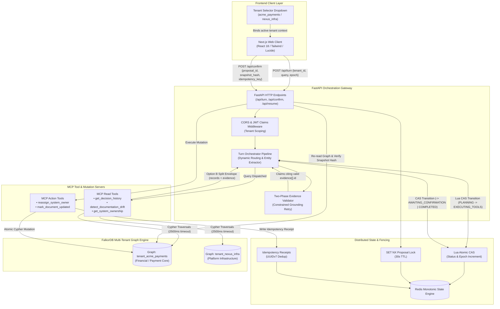

# Engram Architecture & System Specification

> **Track 03:** Decision Provenance & Grounded State Engine  
> **Core Graph Engine:** FalkorDB (Primary Property Graph)  
> **State Coordination:** Redis (Monotonic CAS State Machine, Epoch Fencing, Distributed Lock)  
> **Contract Protocol:** Model Context Protocol (MCP) Option B Split Envelope

---

## 1. Executive Architecture Summary

**Engram** is an enterprise decision intelligence and provenance engine that maps organizational memory into an auditable, temporal property graph. It eliminates hallucinations and organizational documentation drift by coupling deterministic graph traversals with cryptographic grounding and optimistic concurrency control.

### Core Architectural Pillars

1. **FalkorDB Property Graph Topology**:
   - Primary graph store housing people, systems, decisions, documents, and evidence.
   - Physical multi-tenant partitioning: Every tenant graph is strictly isolated under `tenant_{tenant_id}` (derived cryptographically or via tenant tokens), guaranteeing zero cross-tenant leakage at the storage engine level.
   - Temporal edge closures: Relationships such as `[:OWNS]` and `[:SUPERSEDES]` maintain temporal intervals (`valid_from`, `valid_to`) for historical time-travel analysis.

2. **Redis Monotonic CAS State Machine & Epoch Fencing**:
   - Turn state persistence under `turn:{tenant_id}:{session_id}` with a 2-hour TTL (`TURN_TTL_SECONDS = 7200`).
   - Every status transition executes an atomic Lua Compare-And-Set (CAS) script:
     $$\text{if stored\_epoch} == \text{expected\_epoch then increment epoch and mutate state, else reject with HTTP 410 / 409}$$
   - Proposal locks via `lock:{proposal_id}` (`SET NX`, 30s TTL) and idempotency receipts via `idempotency:{key}` ensure strict exactly-once mutation execution.

3. **Option B MCP Split Envelope Contract**:
   - Strict separation between graph metadata (`records[]`) and citable grounding facts (`evidence[]`).
   - The LLM synthesis layer is strictly constrained: answers cite **only** `evidence[].id` items present in the turn's active evidence bag.
   - Cryptographic validation: Every evidence item enforces `content_hash = sha256:hex(sha256(excerpt + "\n" + source_uri))`, preventing phantom citations.

---

## 2. System Architecture & Component Interaction



### ASCII Architecture Flow

```text
┌─────────────────────────┐
│ Next.js Client (UI)     │
│  - Active Tenant State  │
│  - Evidence Drawer View │
└────────────┬────────────┘
             │ HTTP POST /api/turn (tenant_id, user_query, epoch)
             ▼
┌────────────────────────────────────────────────────────┐
│ FastAPI Application Core (main.py)                     │
│  - Tenant Scoping & Settings Injection                │
│  - Orchestrator Pipeline (orchestrator.py)            │
└────────────┬─────────────────────────────┬─────────────┘
             │ Lua CAS Fence               │ MCP Query Dispatch
             ▼                             ▼
┌──────────────────────────┐  ┌──────────────────────────┐
│ Redis State Machine      │  │ MCP Tool Server          │
│  - turn:{tid}:{sess}     │  │  - get_decision_history  │
│  - lock:{proposal_id}    │  │  - detect_drift          │
│  - idempotency:{key}     │  │  - get_system_ownership  │
└──────────────────────────┘  └────────────┬─────────────┘
                                           │ Cypher Traversal
                                           ▼
                              ┌──────────────────────────┐
                              │ FalkorDB Multi-Tenant    │
                              │  - tenant_acme_payments  │
                              │  - tenant_nexus_infra    │
                              └──────────────────────────┘
```

---

## 3. Graph Schema Specification

### 3.1 Node Labels

| Label | Required Properties | Description |
|---|---|---|
| `Person` | `id`, `canonical_email`, `display_name`, `role`, `updated_at` | Team member or system owner. |
| `System` | `id`, `name`, `status`, `updated_at` | Core software system or microservice. |
| `Decision` | `id`, `summary`, `status` (`active` \| `superseded`), `updated_at` | Architectural decision or RFC outcome. |
| `Document` | `id`, `title`, `status` (`current` \| `stale` \| `updated`), `uri`, `last_reviewed_at` | Documentation, PRD, or runbook. |
| `Evidence` | `id`, `record_id`, `excerpt`, `source_uri`, `source_timestamp`, `content_hash` | Verbatim excerpt proving a fact or decision. |
| `Source` | `id`, `uri`, `source_type` (`slack` \| `linear` \| `confluence` \| `notion`), `content_hash` | Upstream origin document or message. |

### 3.2 Temporal & Causal Relationships

| Edge Type | Pattern | Semantics |
|---|---|---|
| `[:OWNS]` | `(p:Person)-[:OWNS {valid_from, valid_to, updated_via}]->(s:System)` | Tracks current (`valid_to IS NULL`) and historic system ownership. |
| `[:SUPERSEDES]` | `(d_new:Decision)-[:SUPERSEDES {reason, valid_from}]->(d_old:Decision)` | Forms a causal directed acyclic graph (DAG) of architectural decisions. |
| `[:AFFECTS]` | `(d:Decision)-[:AFFECTS]->(s:System)` | Identifies which system an architectural decision alters. |
| `[:SUPPORTED_BY]` | `(d:Decision)-[:SUPPORTED_BY]->(e:Evidence)` | Links an architectural decision directly to its verbatim ground truth evidence. |
| `[:PART_OF]` | `(e:Evidence)-[:PART_OF]->(src:Source)` | Connects evidence snippets back to the primary immutable source record. |
| `[:ALIGNED_WITH]` | `(doc:Document)-[:ALIGNED_WITH {created_at}]->(dec:Decision)` | Remediates documentation drift by explicitly linking updated documents to active decisions. |
| `[:PROPOSED]` | `(doc:Document)-[:PROPOSED]->(dec:Decision)` | Documents that originally proposed an architectural change. |
| `[:DOCUMENTS]` | `(doc:Document)-[:DOCUMENTS]->(s:System)` | Identifies the target system a document describes. |

---

## 4. Turn Protocol & Concurrency Fencing

### 4.1 Turn State Machine Lifecycle

```text
       ┌───────────┐
       │ PLANNING  │
       └─────┬─────┘
             │ Lua CAS [epoch -> epoch+1]
             ▼
    ┌─────────────────┐
    │ EXECUTING_TOOLS │
    └────────┬────────┘
             │
     ┌───────┴──────────────────────────┐
     │ Grounded Synthesis               │
     │   • Retry 1: Constrained Prompt  │
     │   • UnverifiableClaim -> FAILED  │
     ▼                                  ▼
┌───────────────────────┐        ┌─────────────┐
│ AWAITING_CONFIRMATION │        │  COMPLETED  │
│ (Mutation Proposal)   │        │ (Read-Only) │
└───────────┬───────────┘        └─────────────┘
            │ POST /api/confirm
            ▼
     ┌─────────────┐
     │  COMPLETED  │
     │  (Mutated)  │
     └─────────────┘
```

### 4.2 Optimistic Concurrency & CAS Fencing Rules

1. **Client Turn Request (`POST /api/turn`)**:
   - Client sends `{tenant_id, session_id, user_query, epoch}`.
   - If `epoch` does not match the stored Redis turn epoch, the request is immediately rejected with **HTTP 410 (Stale Epoch)**.
2. **Proposal Staging**:
   - If a query requires mutation (e.g. drift remediation or owner reassignment), the engine computes a deterministic `snapshot_hash` over the target entities:
     $$\text{snapshot\_hash} = \text{sha256}\left(\text{canonical\_json}(\{record\_id: label\})\right)$$
   - Turn status transitions to `AWAITING_CONFIRMATION`.
3. **Confirmation Fence (`POST /api/confirm`)**:
   - Acquire distributed mutex `lock:{proposal_id}` (`SET NX`, 30s TTL). If locked, return **HTTP 409 (Conflict in Progress)**.
   - Re-read FalkorDB live records and recompute live snapshot hash.
   - If `provided_snapshot_hash != current_snapshot_hash`, abort mutation and return **HTTP 409 (Snapshot Mismatch)** with `current_snapshot_hash`.
   - If matched, execute atomic Cypher mutation, record UUIDv7 receipt under `idempotency:{key}`, advance epoch, and transition turn to `COMPLETED`.

---

## 5. Multi-Tenant Isolation Model

Tenant isolation is strictly enforced across all system layers:

1. **Graph Partitioning**:
   - Graph keys are derived strictly using `resolve_tenant_graph_name(tenant_id)` $\to$ `tenant_{tenant_id}`.
   - FalkorDB isolates graphs into separate physical memory spaces. Queries in `nexus_infra` have zero access to nodes or edges in `acme_payments`.
2. **Redis Key Scoping**:
   - State keys are partitioned by tenant: `turn:{tenant_id}:{session_id}`.
   - Redis flush scripts strictly target specific tenant patterns.
3. **Tool Dispatch Isolation**:
   - All MCP tool signatures require `tenant_id` as their first parameter.
   - MCP tools instantiate a connection strictly to that tenant's graph: `get_tenant_graph(tenant_id)`.

---

## 6. Local Setup & Quickstart Guide

### Prerequisites
- Docker (for FalkorDB and Redis)
- Python 3.11+
- Node.js 18+ and npm

### Step 1: Launch FalkorDB and Redis
Run FalkorDB and Redis locally via Docker:

```bash
# Run FalkorDB on port 6379
docker run -p 6379:6379 -it --rm falkordb/falkordb:v1.0.8
```

*(Note: FalkorDB is built on Redis and provides both Redis key-value and FalkorDB Graph capabilities on port 6379).*

### Step 2: Configure Environment Variables
Copy the example environment files:

```bash
# Backend environment configuration
cp .env.example .env

# Frontend environment configuration
cp frontend/.env.local.example frontend/.env.local
```

### Step 3: Set Up Python Virtual Environment
```bash
# Navigate to backend directory
cd backend

# Create and activate virtualenv
python3 -m venv .venv
source .venv/bin/activate

# Install dependencies
pip install -r requirements.txt
```

### Step 4: Seed Multi-Tenant Demo Graphs
Initialize pristine baseline graphs for `tenant_acme_payments` and `tenant_nexus_infra`:

```bash
# From repository root
python backend/scripts/reset_demo.py
```

Expected output:
```text
Tenant 'tenant_acme_payments': 9 nodes, 10 edges
Tenant 'tenant_nexus_infra': 8 nodes, 8 edges
Total time: < 0.1s
```

### Step 5: Start the FastAPI Backend Server
```bash
# From repository root
uvicorn backend.app.main:app --host 0.0.0.0 --port 8000 --reload
```

Verify backend health at [http://localhost:8000/docs](http://localhost:8000/docs).

### Step 6: Run Track 03 Judging Demo Runner
In a separate terminal, execute the end-to-end automated judging suite:

```bash
# From repository root
python backend/scripts/demo_runner.py
```

Options:
- `--interactive` (`-i`): Pause between each scenario for interactive demonstration.
- `--scenario 1|2|3` (`-s`): Execute a specific judging scenario.
- `--url http://localhost:8000`: Target a remote or custom API URL.

### Step 7: Run Unit and Integration Tests
```bash
pytest backend/tests -v
```
All 76 unit, contract, and end-to-end integration tests must pass cleanly.

### Step 8: Launch the Next.js Frontend
```bash
cd frontend
npm install
npm run dev
```

Open [http://localhost:3000](http://localhost:3000) to access the interactive web interface.
